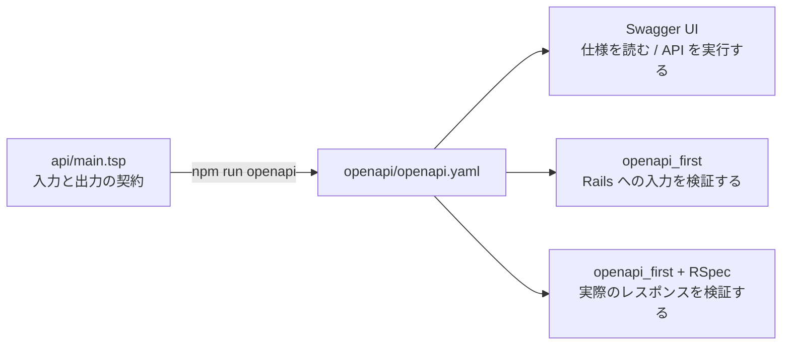

# TypeSpec × openapi_first × Rails

TypeSpec で API の入力と出力を定義し、生成した OpenAPI を Swagger UI の表示と openapi_first の契約検証で共有するデモです。
仕様を変えると、表示するドキュメントと検証する条件が一緒に変わります。
Rails の実装が新しい契約を満たしていなければ、既存の request spec で検出できます。

タスクの作成、一覧、詳細、部分更新だけを用意しています。
ブラウザーの操作は Swagger UI に集約し、専用のタスク画面やフロントエンドサーバーは使いません。

組み合わせの狙いと開発体験は、[解説記事](docs/article.md) にまとめています。
記事で紹介する「仕様の変更が、既存テストの検証条件になる」体験は、以下の段階 4 で再現できます。



## 起動

Ruby 4.0.6、Bundler 4.0.16、Node.js 24.18.0 を用意し、リポジトリのルートで実行します。
バージョンは `.ruby-version`、`.node-version`、`.tool-versions` に指定しています。
Bundler がなければ、先に `gem install bundler --version 4.0.16` を実行してください。

```sh
bin/setup
bin/check
bin/rails server
```

[http://localhost:3000/](http://localhost:3000/) を開くと Swagger UI が表示されます。
`bin/setup` は frozen モードの `bundle install`、`npm ci`、OpenAPI の同期確認、Swagger UI の配置、DB の準備を行います。
既存 DB を初期化し直す処理はありません。
インストール時にはインターネット接続が必要ですが、起動後の Swagger UI はローカルのファイルを読み込みます。

Rails が API、OpenAPI、Swagger UI を同じオリジンで配信します。
TypeSpec のサーバー指定を `/` にしているため、`bin/rails server -p 3001` で起動した場合も、開いたポートへ API を送信できます。

## 4 段階のデモ

| 段階 | 操作 | 見えること |
| --- | --- | --- |
| 1 | Swagger UI から正常な JSON を送る | TypeSpec の仕様を読んで、そのまま実際の API を試せる |
| 2 | 必須項目のない JSON を送る | openapi_first が契約に合わない入力を 400 で拒否する |
| 3 | Rails が必須の `status` を返さなくなる | レスポンスの契約違反を既存の RSpec が検出する |
| 4 | TypeSpec に必須の `completed` を追加する | 仕様だけの変更で同じテストが失敗し、実装を合わせると成功する |

### 1. 仕様を読んで、正常な API を実行する

Swagger UI の `POST /api/tasks` を開き、`Try it out` を押します。
`title` が必須の文字列で、1〜100 文字という定義を確認し、次の本文で `Execute` を押します。

```json
{"title":"契約を読んでAPIを試す"}
```

`Server response` に 201 と次のような実際のレスポンスが表示されます。
`id` は DB の状態によって変わります。

```json
{"id":1,"title":"契約を読んでAPIを試す","status":"todo"}
```

続けて `GET /api/tasks` を実行すると、保存されたタスクを確認できます。
返された id を使い、`PATCH /api/tasks/{id}` で `{"status":"done"}` を送ると状態を更新できます。
一覧の `status` クエリに `done` を指定すると、その状態だけを取得できます。

`api/main.tsp` の `TaskTitle` と `TaskStatus` が入力とレスポンスで再利用され、`openapi/openapi.yaml` に文字数と enum が出力されていることを確認してください。
Swagger UI のスキーマ表示も、この生成済み YAML を読んでいます。

### 2. 契約に合わない入力を送る

同じ `POST /api/tasks` の本文を次へ変え、`Execute` を押します。

```json
{}
```

必須の `title` がないため、`Server response` は 400 と `application/problem+json` になります。
本文の `errors` には契約違反の理由が含まれます。
GET で一覧を取得し、タスクが増えていないことを確認してください。

`{"title":""}`、`{"title":null}`、`{"title":"保存されない","extra":true}` も拒否されます。
`PATCH` に `{"status":"paused"}` を送ると、TypeSpec の enum にない状態として拒否されます。
入力の型、必須項目、文字数、enum、未定義の本文項目は、コントローラーの処理前に openapi_first が検証します。

### 実装や仕様を変更するための作業コピー

段階 3 と 4 は、元のリポジトリと開発 DB を保つため、一時ディレクトリのコピーで行います。
元のリポジトリで `bin/setup` を済ませ、同じターミナルで実行してください。
依存だけを共有し、コードと DB はコピー側を使います。

```sh
sample_root=$(pwd)
exercise_root=$(mktemp -d "${TMPDIR:-/tmp}/tasks-contract-exercise.XXXXXX")
rsync -a \
  --exclude='.git' --exclude='.serena' \
  --exclude='vendor' --exclude='node_modules' \
  --exclude='storage' --exclude='tmp' --exclude='log' \
  --exclude='coverage' \
  "$sample_root/" "$exercise_root/"
ln -s "$sample_root/vendor" "$exercise_root/vendor"
ln -s "$sample_root/node_modules" "$exercise_root/node_modules"
cd "$exercise_root"
mkdir -p storage tmp log
bin/rails db:prepare
bundle exec rspec
```

以後のファイル変更とコマンドは作業コピー内で行います。
`rsync` は macOS に付属し、Linux では OS のパッケージとして利用できます。
このコピーでは依存の追加や更新を行いません。

### 3. 実装が必須項目を返さなくなる

コントローラーを退避します。

```sh
cp app/controllers/api/tasks_controller.rb "$exercise_root/tasks_controller.before-demo.rb"
```

`app/controllers/api/tasks_controller.rb` の `task_json` を、次の 1 行だけ変更します。

```diff
-      task.attributes.slice("id", "title", "status")
+      task.attributes.slice("id", "title")
```

```sh
bundle exec rspec
```

`OpenapiFirst::ResponseInvalidError` が発生し、必須の `status` がないという契約違反で失敗します。
必須項目を一つずつ確認するテストを追加する操作は不要です。
openapi_first が request spec の実際のレスポンスを、TypeSpec から生成した契約へ照合しています。

コントローラーを戻すと、同じテストが成功します。

```sh
cp "$exercise_root/tasks_controller.before-demo.rb" app/controllers/api/tasks_controller.rb
bundle exec rspec
```

### 4. 仕様を先に変更し、実装を合わせる

完了しているかを表す boolean の `completed` を、レスポンスの必須項目に追加します。
`status` が `done` のとき `true`、それ以外は `false` とし、保存済みの状態から計算します。
DB の変更は必要ありません。
`api/main.tsp` の **レスポンス用の `Task`** に、次の 1 行を追加します。
作成と更新の入力モデルは変更しません。

```diff
 model Task {
   id: int64;
   title: TaskTitle;
   status: TaskStatus;
+  completed: boolean;
 }
```

```sh
npm run openapi
bundle exec rspec
```

OpenAPI の `Task` に `completed` の `type: boolean` と required が生成されます。
Rails はまだこの項目を返さないため、段階 3 と同じテストが `completed` の欠落で失敗します。
仕様を追加しただけで、レスポンスの検証条件も更新されています。

次に `task_json` を変更し、保存済みの状態から計算した値を返します。

```diff
-      task.attributes.slice("id", "title", "status")
+      task.attributes.slice("id", "title", "status").merge("completed" => task.status == "done")
```

```sh
bin/check
```

同じ request spec が成功します。
新しい項目の存在と boolean 型は、OpenAPI の契約で検証されます。
`status` が `done` のときだけ `true` になるという意味的な整合性は、この型の契約だけでは検証できません。
その業務動作を保証する場合は、対応するテストを別途追加します。

Swagger UI でも変更を見たい場合は、コピー側で `bin/rails server -p 3002` を起動し、[http://localhost:3002/](http://localhost:3002/) を開きます。
`POST /api/tasks` を実行すると、更新されたスキーマと実際の `completed` を確認できます。
起動中のサーバーは契約を起動時に読み込むため、仕様を再生成した後はサーバーを再起動してください。

演習を終えたら、コピー側のサーバーを止め、元のリポジトリへ戻ります。
コピーの変更は元のコードや DB へ反映されません。

```sh
cd "$sample_root"
bin/check
```

## 契約検証が保証する範囲

openapi_first は、実行されたリクエストとレスポンスを OpenAPI へ照合します。
テストで通していない操作や入力まで、すべての実装が正しいと保証するものではありません。
RSpec は各操作を実行する役割を持ち、API の入力と出力の形は契約から検証します。

| 対象 | このデモで検証する内容 |
| --- | --- |
| API 契約 | 型、必須項目、文字数、enum、クエリ、パス、HTTP ステータス、Content-Type |
| 業務動作 | `todo` で作成する、DB に保存する、絞り込む、送信した項目だけ更新する、404 を返す |
| 保存する値 | Rails のモデル検証と SQLite の NOT NULL、空でない title、status の CHECK 制約 |

TypeSpec から Rails の migration やコントローラーを自動生成する構成ではありません。
仕様に合う入出力を機械的に検証し、保存や検索などの振る舞いは Ruby と RSpec で実装します。
通常稼働時は入力検証、RSpec 実行時は入力とレスポンスの両方の検証を有効にしています。

## 生成とチェック

```sh
# TypeSpec から OpenAPI を生成し、Swagger UI が読む仕様とローカル assets を配置する
npm run openapi

# 保存済み OpenAPI と Swagger UI のローカル assets を public/ へ配置する
npm run openapi:ui

# 保存済み YAML を変更せず、TypeSpec と一致するか確認する
npm run openapi:check

# 同期確認、UI の配置、RSpec をまとめて実行する。CI も同じコマンドを使う
bin/check
```

同期確認は、一時ディレクトリへ生成した YAML と保存済み YAML をバイト単位で比較します。
Swagger UI が読む `public/openapi.yaml` と `public/swagger-ui/` は生成物として Git の追跡対象から除外し、セットアップで再現します。
編集する仕様は `api/main.tsp`、レビューする生成結果は `openapi/openapi.yaml` です。

## 主要ファイル

| ファイル | 役割 |
| --- | --- |
| `api/main.tsp`、`tspconfig.yaml` | API 契約と OpenAPI 3.1 の出力設定 |
| `openapi/openapi.yaml` | Swagger UI と openapi_first が共有する生成済み契約 |
| `config/initializers/openapi_first.rb` | 契約の登録と `/api` 以下の入力検証 |
| `app/controllers/api/tasks_controller.rb` | 4 操作の処理と 3 項目のレスポンス |
| `app/models/task.rb`、`db/migrate/` | 保存する値の検証と DB 制約 |
| `spec/support/openapi_contract.rb` | request spec の入力とレスポンスの契約検証 |
| `spec/requests/tasks_spec.rb`、`spec/models/task_spec.rb` | API の実行と業務動作、モデルと DB の検証 |
| `public/index.html` | ローカルの Swagger UI を起動する小さな HTML |
| `bin/build-api-ui` | 保存済み OpenAPI と Swagger UI の assets を配置する |
| `bin/setup`、`bin/check`、`bin/check-openapi` | lockfile からの準備と検証 |

不正入力の request spec だけは、対象のメソッド、パス、契約違反の種類を指定して意図した失敗を許可します。
その場合もエラーレスポンスの契約検証は行います。
openapi_first 4.2.0 が通常の観測処理では検証を省く 415 については、サポートファイルで同じ操作のレスポンス契約へ照合しています。

## 直接依存

Ruby は Rails 8.1.3.1、sqlite3、Puma、openapi_first 4.2.0、rspec-rails 8.0.4 を使います。
JSON の互換性のため `json` を 2.21.2 に制約し、Windows と JRuby 用に `tzinfo-data` を宣言しています。
rspec-rails は development と test のグループだけに含めています。

Node.js の直接依存は、公式の TypeSpec compiler/http/openapi/openapi3（すべて 1.17.0）と `swagger-ui-dist` 5.33.1 です。
Swagger UI はビルド済み配布物を使うため、このアプリ用の JavaScript バンドラーは不要です。
依存の解決結果は `Gemfile.lock` と `package-lock.json` に保存しています。

## 公式資料と検証記録

- [TypeSpec の HTTP 操作](https://typespec.io/docs/libraries/http/operations/)
- [TypeSpec の組み込み decorator](https://typespec.io/docs/standard-library/built-in-decorators/)
- [OpenAPI 3 emitter の設定](https://typespec.io/docs/emitters/openapi3/reference/emitter/)
- [Swagger UI の導入](https://swagger.io/docs/open-source-tools/swagger-ui/usage/installation/)
- [Swagger UI の設定](https://swagger.io/docs/open-source-tools/swagger-ui/usage/configuration/)
- [openapi_first 4.2.0 と Rails のサンプル](https://github.com/ahx/openapi_first/tree/v4.2.0/examples/rails_app)
- [Rails 8.1 の API モード](https://guides.rubyonrails.org/v8.1/api_app.html)
- [作成と検証の記録](docs/verification.md)
