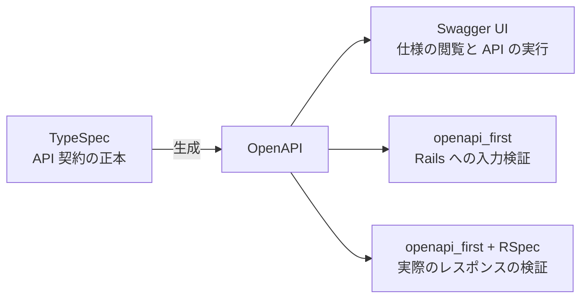

# TypeSpec × openapi_first で、Rails のスキーマ駆動開発が気持ちよくなった

Rails で API を作るとき、先に API 仕様を決めてから実装する進め方があります。
今回は、その仕様を TypeSpec で書き、生成した OpenAPI を openapi_first gem で検証する構成を試しました。

良かったのは、仕様を変えたあと、実装が追従しているかを同じテストで確認できることです。
レスポンスに必須項目を追加すると、その項目を返していない Rails の実装がテストで失敗する。
実装を合わせると成功する。
この流れを、項目ごとの契約チェックをテストに書き足さずに作れました。

AI エージェントに実装を任せるときにも、この構成は役立つと考えています。
実装と API 仕様が合っているかを共通の判定基準で確認できるので、レビューでは仕様の判断や業務の振る舞いに時間を使えます。

## API 仕様とテストの期待値をどうそろえるか

先に API の入出力を決め、クライアントとサーバーがその仕様に沿って開発するのが **API First** の進め方です。
この記事では、機械で読める API 仕様を先に定義し、それをドキュメントと実装の検証に使う進め方を **スキーマ駆動開発** と呼びます。
Rails でこれを実践する一つの方法が、TypeSpec と openapi_first の組み合わせです。

仕様を先に書いても、それに対応するテストの期待値を別々に管理すると、両方を更新する作業が残ります。
たとえば、仕様では `status` が必須なのに、実装でもテストでも `id` と `title` しか確認していなければ、テストは通ってしまいます。
仕様が変わったときも、テスト側に変更を写し忘れれば、その差を検出できません。

AI エージェントには実装とテストをまとめて依頼することがあります。
その際、同じ解釈から実装とテストの期待値が作られると、両者が一致していても、合意した API 仕様との一致は別途確認する必要があります。
これは人が書く場合にも起こる問題ですが、任せる作業が増えるほど、機械的に照合できる判定基準を置いておきたくなります。

そこで、API の入力と出力の条件を仕様から直接読み込んで検証します。
OpenAPI を直接書く方法もありますが、今回は記述するために TypeSpec、Rails で検証するために openapi_first を使いました。

## TypeSpec から OpenAPI の契約検証へ

[TypeSpec](https://typespec.io/) は、API の仕様を記述するための言語です。
TypeScript に似た構文で型や操作を定義でき、OpenAPI などの形式へ出力できます。
[OpenAPI](https://spec.openapis.org/oas/v3.1.0.html) は、HTTP API の仕様を記述するための標準です。
[openapi_first](https://github.com/ahx/openapi_first) は、その定義に対するリクエストとレスポンスの検証を提供する Ruby gem で、Rails にも組み込めます。

今回の構成では、TypeSpec から生成した同じ OpenAPI を、仕様の表示と実際の HTTP の入力と出力の検証に使います。



TypeSpec の書き味は、今回のタスク API の仕様から抜粋したコードを見るとつかめます。

```typespec
@minLength(1)
@maxLength(100)
scalar TaskTitle extends string;

enum TaskStatus {
  todo,
  doing,
  done,
}

model Task {
  id: int64;
  title: TaskTitle;
  status: TaskStatus;
}

model CreateTask {
  title: TaskTitle;
}
```

`TaskTitle` は 1〜100 文字の文字列、`TaskStatus` は三つの値のいずれかです。
作成時の入力とレスポンスで `TaskTitle` を再利用できるので、同じ文字数の条件をそれぞれに書く必要がありません。
モデルの項目は、`?` を付けなければ必須になります。

実際の仕様では、この型に加えて `@get`、`@post`、`@route` などで HTTP の操作とレスポンスのステータスを定義しています。
公式の [OpenAPI emitter](https://typespec.io/docs/emitters/openapi3/reference/emitter/) でコンパイルし、サンプルでは OpenAPI 3.1 の YAML を生成します。
TypeSpec を API 契約の **唯一の正本（Single Source of Truth）** とし、生成した YAML は手で編集しません。
仕様の変更は TypeSpec に加え、OpenAPI を再生成します。

## 仕様に必須項目を追加するとどうなるか

この組み合わせの良さを感じたのが、レスポンスの仕様を変更したときです。
演習用に、タスクが完了しているかを表す `completed` を追加してみます。
まず、レスポンス用の `Task` だけを変更します。

```diff
 model Task {
   id: int64;
   title: TaskTitle;
   status: TaskStatus;
+  completed: boolean;
 }
```

`completed` は必須の boolean です。
入力用のモデルは変更しないので、API を呼ぶ側がこの値を送る必要はありません。
OpenAPI を再生成して、既存のテストを実行します。

```sh
npm run openapi
bundle exec rspec
```

Rails の実装はまだ `completed` を返していないため、テストは次のエラーで失敗します。
サンプルで実行した結果の抜粋です。

```text
OpenapiFirst::ResponseInvalidError:
  Response body is invalid: object at root is missing required properties: completed

35 examples, 11 failures
```

ここでは、既存のテストに `completed` の存在を確認する assertion を追加していません。
新しい OpenAPI を読み込んだ openapi_first が、実際のレスポンスに必須項目がないことを検出しました。
仕様に一行を加えたことで、同じテストの検証条件が変わったことがわかります。

次に、Rails の JSON を作る処理を変更します。
`status` が `done` のときだけ `true` を返すことにします。

```diff
-      task.attributes.slice("id", "title", "status")
+      task.attributes.slice("id", "title", "status").merge("completed" => task.status == "done")
```

サンプルのチェックをもう一度実行します。

```sh
bin/check
```

```text
OpenAPI matches api/main.tsp.
...
35 examples, 0 failures
```

この演習では、仕様を変えたあとにテストファイルを変更していません。
同じ API を実行するテストが、新しい契約では失敗し、実装を合わせると成功しました。
仕様を変更するたびに契約の条件をテストの期待値へ写す作業が減り、実装すべきことに集中しやすくなります。

この時点で追加の契約が検証しているのは、`completed` が存在し、その値が boolean であることです。
すべてのタスクで `false` を返しても、この型の条件は満たします。
`status` が `done` のときだけ `true` になるという意味の正しさは、業務動作のテストで確認する必要があります。

## Rails の入力とレスポンスを照合する仕組み

この検証を動かすため、サンプルでは生成したファイルを登録しています。

```ruby
OpenapiFirst.register(Rails.root.join("openapi/openapi.yaml"))
```

入力は、API の入口に置いたリクエスト検証用ミドルウェアが確認します。
たとえば `POST /api/tasks` に `{}` を送ると、必須の `title` がないため 400 を返します。
型、文字数、enum なども OpenAPI の定義から検証するので、契約に合わない入力をコントローラーの処理前に拒否できます。

レスポンスは、RSpec の request spec が実際に送受信した内容を契約へ照合します。
サンプルでは `OpenapiFirst::Test.setup` でテストの検証を設定し、`OpenapiFirst::Test.observe(Rails.application)` で Rails アプリの実際の入出力を検証するようにしています。
HTTP ステータス、Content-Type、本文の型や必須項目が検証対象です。
通常の API 実行では入力を検証し、RSpec 実行時には入力とレスポンスの両方を検証する構成にしています。

request spec には、API を呼ぶ操作や、DB への保存などの期待を引き続き書きます。
その実行に契約との照合が加わるため、既存のテストを新しい仕様で検証できたという仕組みです。

## AI エージェントに実装を任せるときの流れ

仕様を判定基準にできると、AI エージェントへの依頼も具体的になります。
たとえば、合意した TypeSpec の変更を用意したうえで、次のように実装を依頼できます。

> API 契約は `api/main.tsp` を正本とします。
> レスポンスに必須の `completed: boolean` を追加しました。
> `status` が `done` のとき `true`、それ以外は `false` を返すように Rails を変更してください。
> OpenAPI を再生成し、`bin/check` が成功することを確認してください。
> 契約を満たすために仕様を緩めたり、契約検証を無効にしたりせず、仕様変更が必要なら理由を提示してください。
> `completed` と `status` の関係は型だけでは検証できないため、業務動作のテストも追加してください。

テストで実行したレスポンスに、仕様で定義した必須項目が不足していれば、契約検証がその項目を示します。
エージェントも人も、その結果を受けて修正し、同じチェックで確認できます。
エージェントが自分で書いたテストの期待値だけに頼らず、合意した仕様からのフィードバックを使える構成です。

サンプルでは、その前段に生成物の同期チェックも置いています。
`bin/check` は TypeSpec を一時ディレクトリで再コンパイルし、保存済みの OpenAPI と比較してから RSpec を実行します。
TypeSpec を更新して YAML の再生成を忘れた場合も、YAML だけを手で変更した場合も、ここで不一致を検出します。
CI も同じコマンドを使うので、ローカルだけの確認手順になりません。

## 契約検証と業務の正しさの境界

契約検証が照合するレスポンスは、テストで実行したものです。
テストで実行していない経路や条件について、レスポンスの正しさまで保証されるわけではありません。
request spec でどの操作とケースを実行するかは、引き続き設計します。
今回の TypeSpec から Rails のコントローラーや migration を自動生成する構成でもありません。
保存、検索、認可などの振る舞いは Rails に実装します。

仕様そのものの判断も残ります。
TypeSpec と実装を両方変えれば、意図しない仕様変更でも契約に適合してしまう可能性があります。
生成物の同期チェックは「決めた仕様が正しいか」までは判断しないので、レビューでは TypeSpec の差分と業務要件を確認します。

契約との照合を機械に任せられる分、エージェントへの依頼とレビューを、仕様の判断、保存や更新の振る舞い、エラー時の扱い、コードの読みやすさへ向けられます。

## サンプルで同じ失敗と成功を体験する

今回試した構成を、[TypeSpec × openapi_first × Rails のサンプルリポジトリ](https://github.com/AudioStakes/rails-typespec-openapi-first-sample) に用意しています。
タスクの作成、一覧、詳細、更新だけの小さな API で、ブラウザーからの操作は Swagger UI にまとめています。
アプリの起動と変更の手順は、リポジトリの README にあります。

まず Swagger UI から正常な入力を送り、続けて必須項目のない入力が 400 になることを確認できます。
README の段階 3 では実装から `status` の返却を外し、段階 4 ではこの記事の `completed` を追加します。
どちらも作業コピーで行うため、元のアプリと DB を保ったまま、契約違反の検出と修正を試せます。

とくに試してほしいのは、段階 4 でテストファイルを変更せず、仕様と実装を順番に変更する流れです。
TypeSpec で決めた仕様が OpenAPI を通して検証条件になり、Rails がその契約に適合したかを同じテストで確かめられる。
この小さな変更を一度試すと、仕様を正本にして開発する手応えが得られると思います。

動作確認には Rails 8.1.3.1、TypeSpec 1.17.0、openapi_first 4.2.0 を使用しました。
サンプルでは Ruby と Node.js の版と依存の lockfile も固定しています。
